# Guard + runtime_config — UML 2 十四图

**Scope:** Runtime Guard（detect / report / dump）+ `runtime_config`（control plane）。  
**Sources:** 本仓 [01 如何启动](../01_enable_and_start/README.md)、上游 `runtime_guard` / `runtime_config` 源码与产品文档；符号清单见 `guard-uml-inventory-20261021`。  
**Wiring:** 主产品树仅 **MRV2**（`worker/v2/model_runner.py`）；**MRV1** 经本仓 [05_mrv1_backport](../05_mrv1_backport/README.md) 离线 patch（与 [05_v030](../05_v030_backport/README.md) MRV2 勿叠打）。

Mermaid 表达不了的类型（Profile / Timing / Communication 部分）用 **PlantUML-style / ASCII** 标注。

---

## 1. Class 类图

核心类型与继承/组合：`RuntimeConfigBootstrap` → `RuntimeConfig`；`RuntimeGuardProcessor` 组合 Bus/Dump/Report mixins 与 `DetectorManager`。

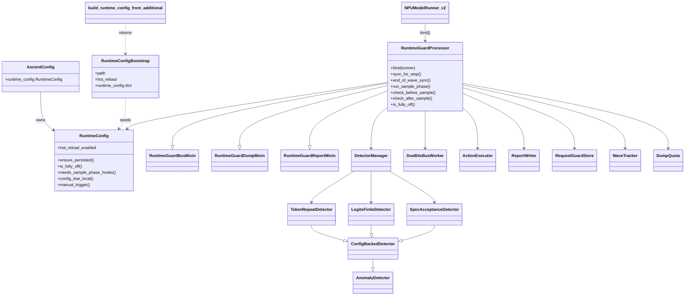

---

## 2. Object 对象图

某一 wave 上 last-PP 的典型实例快照（hot_reload 开、token_repeat 开）。

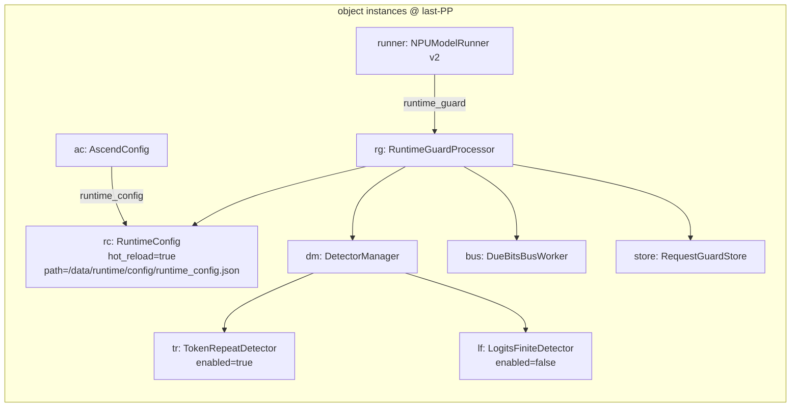

---

## 3. Component 组件图

部署边界上的可替换组件与产物目录。

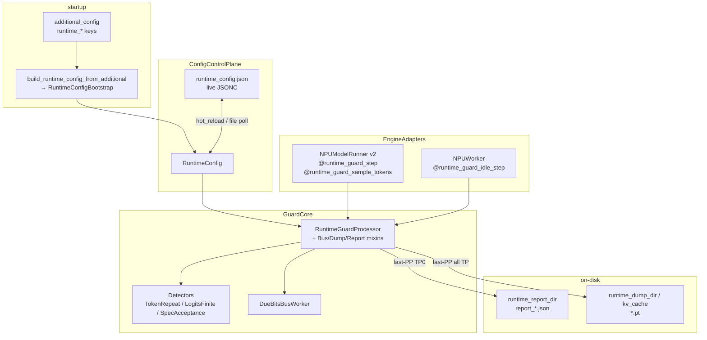

---

## 4. Composite Structure 复合结构图

`RuntimeGuardProcessor` 内部端口：wave sync / sample phase / due bus。

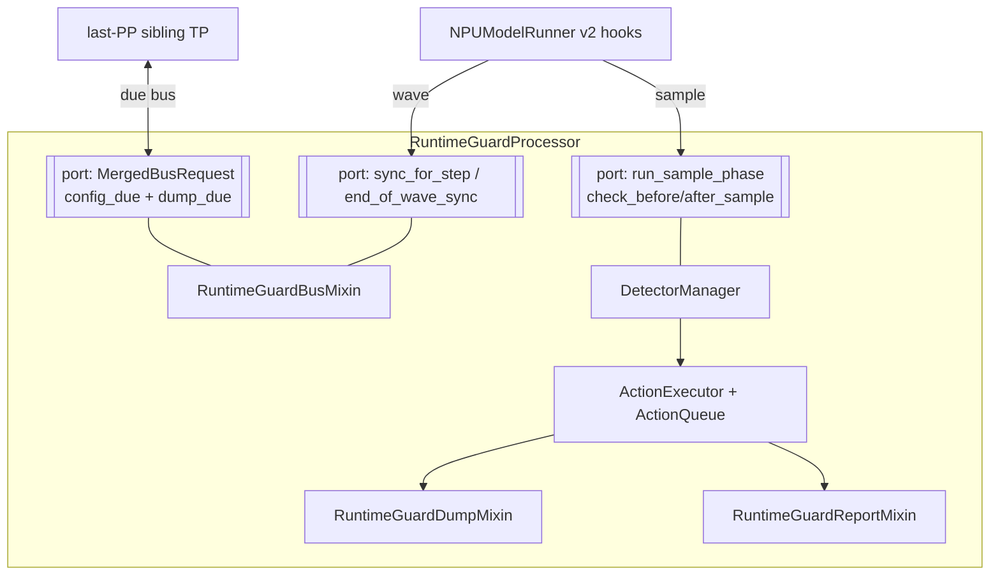

---

## 5. Deployment 部署图

多 rank 节点：last-PP TP0 写 report；同 stage 其它 TP 经 due bus；非 last-PP file poll。

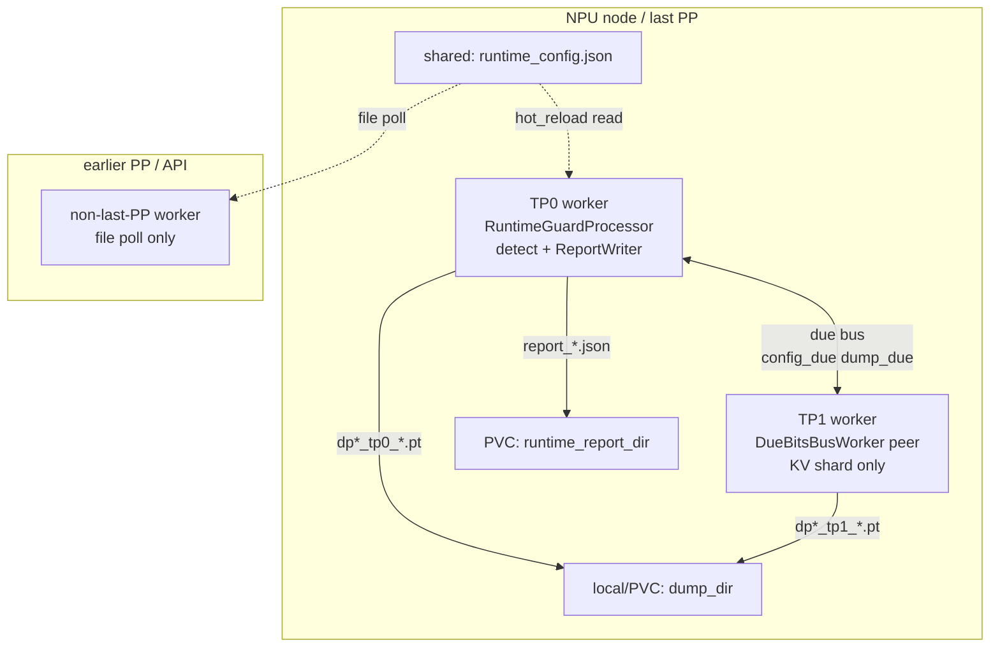

---

## 6. Package 包图

与清单建议的五包划分一致。

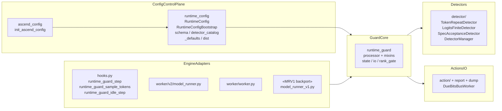

---

## 7. Profile 概要图（轻量 stereotypes）

Mermaid 无原生 Profile；下列为 **PlantUML-style** stereotypes（扩展点，非正式 metamodel）。

```plantuml
@startuml
skinparam packageStyle rectangle
profile RuntimeGuardProfile {

  stereotype «ControlPlane» {
    RuntimeConfig, RuntimeConfigBootstrap
  }
  stereotype «Detector» {
    TokenRepeatDetector, LogitsFiniteDetector, SpecAcceptanceDetector
  }
  stereotype «Action» {
    ReportAction, DumpKvAction
  }
  stereotype «RankGate» {
    lastPP_TP0_detect_report
    lastPP_allTP_dump
    nonLastPP_file_poll
  }
  stereotype «EngineHook» {
    runtime_guard_step
    runtime_guard_sample_tokens
    runtime_guard_idle_step
  }
  stereotype «MRV1Only» {
    runtime_guard_pre_sample_logits
    build_v1_async_gpu_output
  }
  stereotype «IdleMode» {
    static_idle = is_fully_off()
    worker_idle = execute_dummy_batch + idle_step
  }
}
@enduml
```

---

## 8. Use Case 用例图

运维与引擎两侧主要用例。

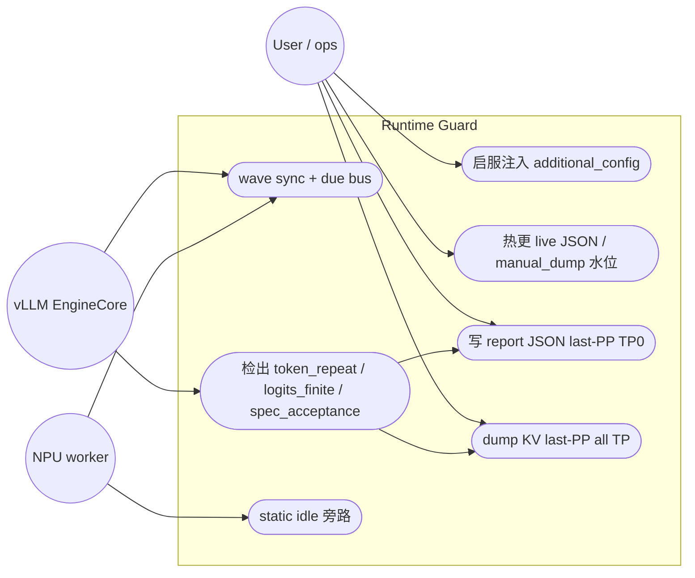

---

## 9. Activity 活动图

从 `additional_config` 到 hit → report/dump。

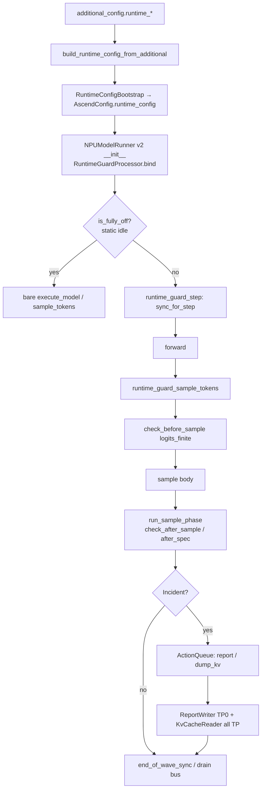

---

## 10. State Machine 状态机

进程级 Guard 热路径门控（`RuntimeConfig` / `is_fully_off`）。

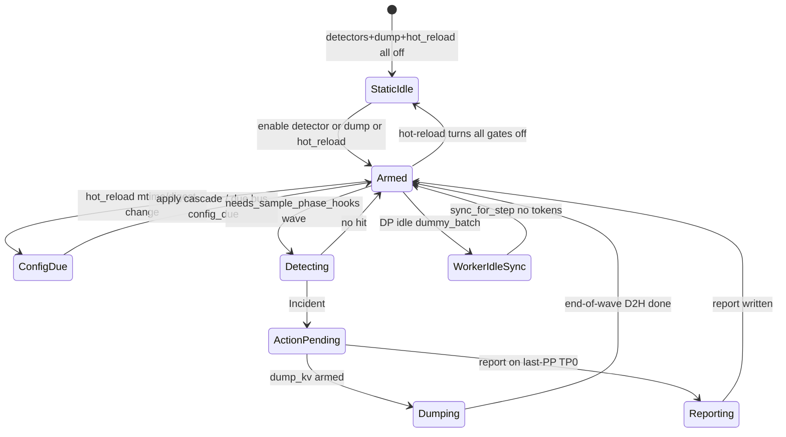

---

## 11. Sequence 序列图

busy wave：step → sample → due bus drain。

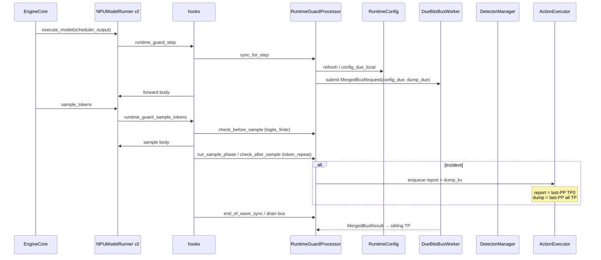

---

## 12. Communication 通信图

Mermaid 无原生 communication diagram；下列为 **编号消息协作图**（UML Communication）。

```text
                    (1) sync_for_step
  EngineCore ---------------------> RuntimeGuardProcessor
                                          |
                         (2) submit due bus | (5) check_after_sample
                                          v
                                   DueBitsBusWorker
                                          |
                         (3) broadcast[wave, config_due, dump_due]
                                          v
                               last-PP TP1..TPn  ----(4) local KV shard----> dump_dir

  RuntimeGuardProcessor --(6) ReportAction--> ReportWriter --(7)--> runtime_report_dir
  RuntimeGuardProcessor --(8) DumpKvAction--> KvCacheReader --(9)--> dump_dir

  Non-last-PP / API --(F) file poll--> runtime_config.json
  Ops --(0) edit JSON / raise manual_dump--> runtime_config.json
```

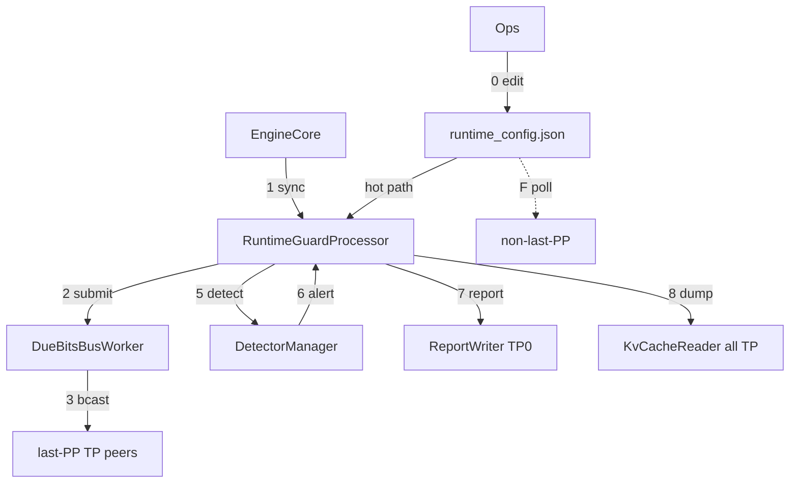

---

## 13. Timing 时间图

Wave 内 due-bus 与 forward 重叠；async after-sample 可能晚于 finish。  
（Mermaid **gantt** 近似 UML Timing。）

```mermaid
gantt
  title last-PP wave timing (schematic)
  dateFormat X
  axisFormat %s
  section TP0
  sync_for_step + due-bus submit     :a1, 0, 1
  forward compute                     :a2, 1, 5
  sample + logits_finite / token_repeat :a3, 5, 7
  end_of_wave drain bus + dump D2H    :a4, 7, 9
  section TP peer
  due-bus collective wait/overlap     :b1, 0, 5
  apply config_due / dump_due         :b2, 7, 8
  write local *.pt                    :b3, 8, 9
  section async
  AscendAsyncOutput.get_output after-sample :c1, 8, 10
```

```text
time →
TP0:   |--sync+submit--|-- forward --|-- sample/detect --|-- drain/D2H --|
peer:  |<<<< due bus overlap >>>>>>>>|---- apply due ----|-- .pt write --|
async:                                            |---- get_output drain ----|
static idle: bare runner (no sync shells)
worker idle: idle_step sync only (no scheduled tokens)
```

---

## 14. Interaction Overview 交互概览图

活动图骨架 + 嵌入交互引用（ref）。

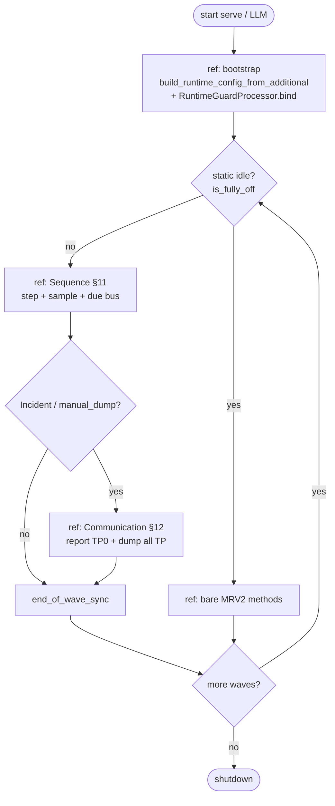

---

## 相关链接

| 文档 | 路径 |
|------|------|
| 启停 | [01_enable_and_start](../01_enable_and_start/README.md) |
| MRV1 接线 | [05_mrv1_backport](../05_mrv1_backport/README.md) |
| MRV2 v0.30 | [05_v030_backport](../05_v030_backport/README.md) |
| 上游 feature | `vllm-ascend` `docs/.../runtime_guard.md` |
| 上游 JSON | `vllm-ascend` `docs/.../runtime_config.md` |
